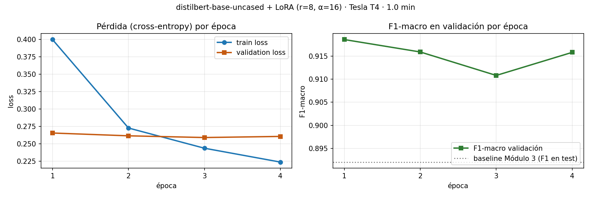

# DS III · Pre-entrega 4 — Clasificación con fine-tuning eficiente mediante LoRA

Proyecto integrador de **Data Science III: NLP & Deep Learning aplicado a Ciencia de Datos** (Coderhouse).
Autora: **Elizabeth Luque**

Clasificación de noticias **AG News** (Business, Sci_Tech, Sports, World) con un Transformer preentrenado ajustado mediante **LoRA (PEFT)**, comparado contra el baseline TF-IDF + Naive Bayes de la [Pre-entrega 3](https://github.com/scarletluque0805/ds3-clasificador-tfidf) (F1-macro 0,892 en test).

## Avance

| Parte | Pasos de la práctica | Estado |
|---|---|---|
| **1 · Datos, modelo base y configuración LoRA** | 1 · 2 · 3 | ✅ `notebooks/04_parte1_datos_modelo_lora.ipynb` |
| **2 · Fine-tuning en GPU y ablación** | 4 | ✅ `notebooks/04_parte2_finetuning_lora.ipynb` ejecutado en Colab (Tesla T4) |
| **3 · Benchmark contra el Módulo 3 y reporte PDF** | 5 | 🔄 `notebooks/04_parte3_benchmark.ipynb` listo para ejecutar |

## Parte 1 · Decisiones

### Datos (Paso 1)
- Carga con `data/cargar_dataset.py` de la cátedra. `label` → entero en orden alfabético (`Business=0, Sci_Tech=1, Sports=2, World=3`) y `DatasetDict` de Hugging Face.
- **Splits:** train 7.200 / validation 800 (90/10 estratificado del train original) / **test 2.000 = el mismo del baseline del Módulo 3**.
- **Entrada al modelo:** solo la limpieza estructural del Módulo 2 (HTML, URLs, firmas de agencia, datelines), **sin lematizar ni quitar stop-words**, porque el Transformer necesita texto natural y su contexto.
- **`max_length = 72`**: p95 de sub-tokens WordPiece, el mismo valor del EDA del Módulo 2. Cubre el 95,7% de las noticias sin truncar, con padding dinámico.

#### Convenciones de tokenización, padding y truncado
Las dejo explícitas para que el resultado se pueda reproducir tal cual:

| Aspecto | Convención que uso |
|---|---|
| Tokenizer | WordPiece de `distilbert-base-uncased` (pasa todo a minúsculas, vocabulario de 30.522 sub-tokens) |
| Tokens especiales | `add_special_tokens=True` (default): cada noticia queda `[CLS] … [SEP]`. **El largo que mido para el p95 ya incluye esos 2 tokens**, así que 72 es el largo total que recibe el modelo |
| Cómo mido el largo | `len(input_ids)` de cada noticia del train **sin truncar**. Es un conteo por documento, no de ocurrencias totales |
| Truncado | `truncation=True, max_length=72` en `src/entrenamiento.py::tokenizar`. Se recorta el final y `[SEP]` se conserva siempre |
| Padding | Dinámico con `DataCollatorWithPadding`. Relleno con `[PAD]` (id 0) solo hasta la noticia más larga de cada lote, y la `attention_mask` pone 0 en esas posiciones para que la atención las ignore |
| Splits | Los mismos de las pre-entregas anteriores: test de 2.000 noticias idéntico al del Módulo 3, validación 10% estratificada con `seed=42` |

### Modelo base (Paso 2): `distilbert-base-uncased`

| Modelo | Idioma | Capas | Parámetros | Entrenables con LoRA (r=8, Q-V) |
|---|---|---|---|---|
| **distilbert-base-uncased** ✅ | Inglés | 6 | 66,96 M | 741.124 (1,11%) |
| bert-base-uncased | Inglés | 12 | 109,49 M | 297.988 (0,27%) |
| roberta-base | Inglés | 12 | 124,65 M | 888.580 (0,71%) |
| distilbert-base-multilingual-cased | 104 idiomas | 6 | 135,33 M | 741.124 (0,55%) |

Corpus en **inglés** → modelo monolingüe en inglés (el multilingüe gasta el 68% de sus parámetros en embeddings de 104 idiomas). **6 capas** → la mitad de cómputo que BERT y RoBERTa, reteniendo alrededor del 97% de su desempeño. Es una tarea de comprensión de 4 temas con 7.200 ejemplos, y entra cómodo en una T4 gratuita. `roberta-base` queda como techo opcional.

### LoRA (Paso 3)

| Hiperparámetro | Valor | Por qué |
|---|---|---|
| `r` | 8 | tarea simple y cercana al preentrenamiento: rango intrínseco bajo (se valida con una ablación 4 / 8 / 16 en la Parte 2) |
| `lora_alpha` | 16 | escala α/r = 2 (convención estándar) |
| `target_modules` | `q_lin`, `v_lin` | Query y Value de la atención en las 6 capas: la mejor relación desempeño/parámetros según el paper de LoRA |
| `lora_dropout` | 0,1 | regulariza los adaptadores |
| learning rate (Parte 2) | 3e-4 | con el modelo base congelado no hay *catastrophic forgetting*; los adaptadores nuevos necesitan pasos más grandes que el 2e-5 del fine-tuning completo |

**Parámetros:** 741.124 entrenables de 66.956.548 (**1,11%**): 147.456 en adaptadores LoRA (0,22%) y 593.668 en el cabezal de clasificación nuevo. Se verificó que el Transformer base queda congelado y que las matrices B arrancan en cero.

## Parte 2 · Fine-tuning (Paso 4)

[](https://colab.research.google.com/github/scarletluque0805/ds3-transformer-lora/blob/main/notebooks/04_parte2_finetuning_lora.ipynb)

`Trainer` de Hugging Face con padding dinámico, `fp16` y evaluación por época, conservando la mejor época según el F1-macro de validación. Corridas:

| Corrida | r / α | learning rate | Objetivo |
|---|---|---|---|
| **principal** | 8 / 16 | 3e-4 | modelo de la entrega |
| lr_3e-5 | 8 / 16 | 3e-5 | mostrar que el lr del fine-tuning completo es bajo para LoRA |
| r4 · r16 | 4 / 8 · 16 / 32 | 3e-4 | validar la elección de `r` |
| roberta_r8 (opcional) | 8 / 16 | 3e-4 | techo de referencia con 12 capas |

**Resultados en validación (Tesla T4, 800 noticias):**

| Corrida | % entrenable | train loss final | val loss final | F1-macro val (mejor época) | Tiempo |
|---|---|---|---|---|---|
| **principal** (r=8, lr 3e-4) | 1,11% | 0,224 | 0,261 | **0,9186** (época 1) | 0,98 min |
| lr_3e-5 | 1,11% | 0,316 | 0,299 | 0,8982 (época 4) | 0,84 min |
| r4 | 1,00% | 0,234 | 0,257 | 0,9146 (época 3) | 0,77 min |
| r16 | 1,33% | 0,210 | 0,262 | 0,9200 (época 1) | 0,78 min |
| roberta_r8 (techo) | 0,71% | 0,218 | 0,222 | 0,9260 (época 3) | 1,48 min |

- **Learning rate:** con 3e-5, el valor del fine-tuning completo, el modelo arranca con una pérdida de 0,88 y termina 2 puntos abajo: los adaptadores no llegan a ajustarse en 4 épocas. Con 3e-4 alcanza su mejor F1 en la primera época.
- **Rango:** r=4, 8 y 16 quedan a menos de 0,6 puntos entre sí. La tarea tiene rango intrínseco bajo, como se anticipó en la Parte 1, y r=8 es un punto medio razonable.
- **Sin sobreajuste:** la pérdida de validación se estabiliza en torno a 0,26 mientras la de train sigue bajando. Por eso `load_best_model_at_end` conserva la mejor época.
- **RoBERTa** (12 capas) gana 0,7 puntos en validación con un 51% más de tiempo y el doble de VRAM.
- **Reproducibilidad:** ejecuté el notebook dos veces en sesiones distintas de Colab y obtuve métricas idénticas y el mismo adaptador, bit a bit (semilla 42).



## Estructura

```
ds3-transformer-lora/
├── data/                 # cargar_dataset.py (cátedra) + ag_news/ (train y test originales)
├── src/
│   ├── limpieza.py       # limpieza estructural del Módulo 2 (regex, sin spaCy)
│   ├── datos_hf.py       # label -> int, splits y DatasetDict de Hugging Face
│   ├── modelos.py        # candidatos del Hub, LoraConfig y conteo de parámetros
│   ├── entrenamiento.py  # tokenización, métricas, TrainingArguments y entrenamiento con LoRA
│   └── evaluacion.py     # carga del adaptador, inferencia y test de McNemar
├── notebooks/
│   ├── 04_parte1_datos_modelo_lora.ipynb
│   ├── 04_parte2_finetuning_lora.ipynb
│   └── 04_parte3_benchmark.ipynb
├── reports/
│   ├── baseline_modulo3.json   # métricas del baseline TF-IDF (Pre-entrega 3)
│   ├── baseline_predicciones_test.csv  # predicciones del baseline sobre el mismo test
│   ├── config_parte1.json      # configuración que usa la Parte 2
│   ├── parte2/                 # historiales, resumen de corridas, figuras y entorno de GPU
│   └── figures/
├── models/lora_distilbert_r8/   # adaptador LoRA entrenado (3 MB)
├── assets/               # vocabulario WordPiece (respaldo sin acceso al Hub)
└── requirements.txt
```

## Cómo ejecutarlo

En Google Colab con GPU (`Entorno de ejecución → Cambiar tipo de entorno → T4 GPU`):

```python
!git clone https://github.com/scarletluque0805/ds3-transformer-lora.git
%cd ds3-transformer-lora
!pip uninstall -y -q torchao          # la versión que trae Colab choca con peft >= 0.16
!pip install -q -r requirements.txt
```

y abrir `notebooks/04_parte1_datos_modelo_lora.ipynb`. La Parte 1 también corre en CPU. Igual no hace falta hacer esto a mano: la primera celda de cada notebook ya clona el repo e instala lo necesario cuando detecta Colab.

En una máquina propia (Python 3.10 a 3.13):

```bash
python -m venv .venv && source .venv/bin/activate      # en Windows: .venv\Scripts\activate
pip install -r requirements.txt
```

### Versiones
En `requirements.txt` uso **rangos** y no versiones fijas. En las pre-entregas anteriores había fijado las versiones exactas de mi entorno local, y en un entorno con Python 3.11 la instalación fallaba. Con rangos, pip elige la combinación que existe para cada versión de Python. Las versiones exactas con las que entrené están registradas en `reports/parte2/entorno.json`.

Para no repetir el error, esta vez lo verifiqué antes de subirlo:

| Prueba | Esperado | Observado |
|---|---|---|
| `uv pip compile` de `requirements.txt` para Python 3.10, 3.11, 3.12 y 3.13 | resuelve en las 4 | ✅ resuelve en las 4. En 3.10 baja solo a numpy 2.2.6 y torch 2.14.1; en 3.11 elige numpy 2.4.6 |
| Instalación en un venv **nuevo con Python 3.11** (todo menos torch) | instala sin errores | ✅ transformers 5.22.2, peft 0.21.2, datasets 5.1.0, numpy 2.4.6, pandas 3.1.1 |
| Ejecución real del entrenamiento y la evaluación | corre de punta a punta | ✅ en Colab: torch 2.14.1, transformers 5.22.1, datasets 4.8.5, todas dentro de los rangos. Lo corrí 3 veces y las métricas dieron idénticas |

torch no lo reinstalé en el venv de prueba porque la versión con CUDA pesa varios GB. Colab y Kaggle ya lo traen, y su instalación queda cubierta por la prueba de resolución.
